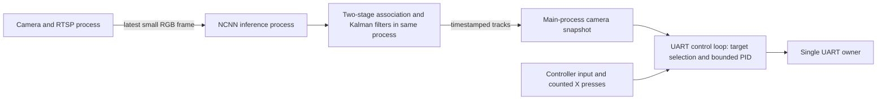

# Person tracking and following

## Controller operation

Launch `.venv/bin/python main.py` as usual. Following starts **disabled**.
Following mode is controlled only by X; the usual controller/rover health and
neutral interlocks still govern whether motors may run:

1. Tap controller **X** to start acquisition. The rover stays stopped while a
   persistent person is selected from roughly one second of fresh observations.
   The default reference asks it to close in from this initial distance. Use
   `--follow-distance-scale 1` to maintain the acquisition distance instead.
2. Once locked, the rover centers that person and drives forward or **reverses**
   to keep their apparent width near the learned setpoint. Walking away reduces
   that width and requests forward movement; approaching increases it and
   requests reverse.
3. Moving left-stick Y or right-stick X temporarily gives manual control
   priority. Release the driving axes to neutral and following resumes
   automatically, using the current person observation.
4. Losing the person stops autonomous motion, but keeps the mode enabled.
   The rover waits and automatically reacquires a visible person.
5. Tap **X** again to disable following and stop its motor request. This works
   while waiting, searching or driving manually too. Only X changes the mode;
   a fresh application run starts with the mode off.

X is bound to Linux `BTN_NORTH` by default. Presses are counted by the input
reader, so a short released tap is retained between control ticks and holding X
does not repeatedly toggle. Startup/reconnection, already-held buttons and
dropped-event resynchronization cannot create a synthetic toggle. X activation
has been confirmed by the user's live test. Use `--controller-only` and the keys
row/JSON to inspect another controller; `--follow-button` overrides the binding.
The existing two-stick manual mapping needs no shoulder button.

The CLI shows `OFF`, `ON/search`, `ON/follow`, `ON/manual` or `ON/wait`, plus
target ID and width; larger terminals also show
target center, source age and desired width. JSON retains the complete
`rover.drive.following` status and wait/activity reason. JSON distinguishes
`enabled`, `manual_override`, `target_valid`, `motion_active`, target age and
requested throttle/turn, image errors and PID integral terms. The separate
`rover.drive.following_output` contains average wheel demand, pulse duty and
whether a pulse is on. `ON/follow` with zero wheel output during the off part
of a pulse cycle is expected. The displayed motor limit uses
the currently active manual/following cap. The complete remote ffplay command
remains above the table. Video boxes show person IDs, with amber `?` labels for
ambiguous associations.

X can enable the mode before the camera/person is ready; it waits without
requesting movement. If detection is disabled, enable it with terminal **D**.
Disabling detection suspends autonomous motion without changing the X mode;
fresh observations after re-enabling allow automatic acquisition/resume.
`--no-drive`, `--no-controller`,
`--controller-only` and `--camera-only` never enable autonomous motor writes.

```bash
.venv/bin/python main.py
.venv/bin/python main.py --follow-power 1 --follow-min-power .5
.venv/bin/python main.py --follow-pulse-ms 40 --follow-turn-limit .2  # Gentler turns
.venv/bin/python main.py --follow-distance-scale 1.4  # Closer automatic reference
.venv/bin/python main.py --follow-width .20  # Optional fixed distance proxy
.venv/bin/python main.py --no-drive --json  # Observe detections/tracks; no motor writes
```

By default, the distance reference is **1.25 times** the first acquired person's
filtered normalized width, capped at 0.8. Larger apparent width asks for a closer
position. `--follow-distance-scale` accepts 1–2: 1 holds the acquisition width,
1.25 closes in and 1.4 asks for an even closer position. The reference is learned
once per X session, and retained through manual
override, target reacquisition and camera recovery. X off/on learns a new
reference. If the person is horizontally clipped, steering continues but
calibration/translation waits until their full width is visible.

`--follow-width` explicitly selects a fixed normalized width in 0.03–0.8 and
does not apply the automatic distance multiplier.
For example, 0.15 is 96 pixels at a 640-pixel output width. A larger setpoint
asks the rover to stay closer for the same person/camera geometry. It is not distance in
metres. Person size, orientation, camera field of view and partial visibility
affect the signal. Horizontal clipping still allows steering and reverse, but
suppresses approach because a truncated box underestimates the person's width.

`--follow-power` defaults to **1.0**; `--follow-min-power` is now the minimum
**pulse amplitude**, default **0.5**. After differential mixing and power caps,
average wheel demand ramps at 2 normalized units per second. Small demands are
delivered as **60 ms on pulses**, with off time determined by the requested
average effort. For example, a 10% average request uses 50% pulse power for
about 60 ms on / 240 ms off. Both wheels share the gate and scale factor, keeping
their ratio. `--follow-pulse-ms` accepts 40–150 ms; actual edges occur on control
ticks (normally about 20 ms apart), so timing is approximate.

`--follow-turn-limit` defaults to **0.25** before the overall power cap: with
default caps a pure turn requests at most 25% average effort, delivered as 50%
pulses with roughly equal on/off time. Small yaw errors produce sparser pulses.
For larger mixed/translation requests, once duty would leave less than one
control tick off between pulses (75% duty with the defaults), the requested PWM
is delivered continuously. It can increase to the configured power cap. A
minimum of 0 disables pulses and uses continuous proportional effort instead.

This output stage has no sleeps, command queue or additional thread. Elapsed
on/off time sets the next pulse; at most one control tick of positive credit is
retained for timing quantization. Stops, loss, authority changes and direction
reversals clear it. A reversal first sends zero. Starts and stops reach UART
on the current control tick; ordinary command refresh stays at 20 Hz. These
software pulses do not change the motor board's hardware PWM carrier frequency.

`--max-power` is a hard cap for both modes, default **1.0**. Manual driving has
its own `--manual-power`, default **0.5**, so raising following effort does not
raise manual driving power. An explicit smaller hard cap clips both modes and
also clips the following minimum. These are normalized PWM power limits, not
measured RPM. Stops bypass the ramp; pulse amplitudes apply immediately to
overcome breakaway friction. Automatic reverse remains enabled.

The earlier 25% minimum/50% cap produced only slight motion; raising the
continuous minimum to 50% helped but made turns too aggressive. Applying that
minimum only during short pulses permits gentler correction with useful torque.
Tyre slip and actual traction still require physical tuning.

## Architecture and tracking algorithm



The reference analysis is in [person-following-reference.md](person-following-reference.md).
The Pi uses the existing NCNN model, with no TensorRT, ROS, PyTorch, Ultralytics
runtime or new dependency. [tracking.py](../apptirover/tracking.py) implements a
small **ByteTrack-style** association pipeline rather than importing the exact
Ultralytics implementation:

- Source-time constant-velocity Kalman filters estimate center X/Y, width/height
  and their rates. All prediction, covariance updates and association run in the
  inference process, away from UART and Bluetooth execution.
- Global minimum-cost assignment matches strong person detections using box IoU,
  confidence, a center innovation gate and size consistency. Remaining active
  tracks can match weaker boxes with a stricter IoU gate. Weak boxes cannot start
  a new track or revive an already lost track.
- High threshold is the configured `--confidence` (default 0.35), low threshold
  is `min(0.1, confidence/2)`, and new-track threshold matches `--confidence`.
  Detector decoding keeps the low-score interval for association; the normal
  `boxes`/`people` display still applies `--confidence`. The previous separate
  0.5 new-track threshold could display a person without ever creating a track.
- Empty frames advance prediction and retention too. On each observation,
  unmatched tracks expire 0.75 seconds after their last measurement, with IDs never
  reused within the detector process. Each distinct source frame is processed
  once. Camera generations reset association state.
- Work is bounded to 64 detections and 32 retained tracks. Close competing
  assignments and overlapping measured people flag ambiguity. There are no
  appearance embeddings or guarantees of recognizing a particular individual.

[following.py](../apptirover/following.py) consumes these small snapshots. During
acquisition, it keeps bounded timestamped candidate votes. After about one
second, a current confirmed candidate must occur in at least 80% of that window's
fresh observations (and at least three observations). Candidates rank by count,
then mean confidence, as in the reference. Equal candidates break ties by image
center proximity, then ID, rather than remaining stationary indefinitely.
Only the committed winner's box seeds control. Repeated snapshots add no votes.

After acquisition the ID remains preferred. If it disappears, a unique nearby
replacement can continue the track for up to one second: its center must be
within 0.12 of the previous center extrapolated with estimated velocity, and
width/height ratios must each be between 0.5 and 2. Multiple plausible replacements
leave motion stopped. After longer loss, normal acquisition runs again
automatically. A selected target must be confirmed, measured in the current
source frame, finite, geometrically valid and unambiguous. Prediction preserves
identity memory and helps association; it never authorizes motion by itself.

The controller now uses two bounded PID loops:

```text
yaw_error = center_x - 0.5
distance_error = log(reference_width / width)
yaw PID: Kp=0.65, Ki=0.45, Kd=0.08, output limit=0.25
distance PID: Kp=0.35, Ki=0.45, Kd=0.05, output limit=1
```

Positive turn points the rover's nose right. Smaller boxes request forward
movement; larger boxes request reverse. Center error within 0.03 suppresses yaw;
width ratios within 10% suppress translation. Translation decreases with
horizontal error and reaches zero at an offset of 0.3. Both axes are bounded
before differential mixing and pulse delivery. The lower proportional terms
reduce immediate response; integral can dominate a persistent small error after
about 1.4 seconds for yaw and 0.8 seconds for distance. Integral action grows only
once per fresh source frame, with a maximum 0.2-second integration step and
an integral contribution bounded to the smaller of 0.5 and the axis output limit.
Conditional anti-windup uses each axis's actual limit. As the error shrinks,
stored integral scales down with it, reducing overshoot. Derivative damping is
bounded to half the combined proportional/integral effort so a velocity estimate
cannot reverse a persistent position error. Error entering its deadband or reversing sign clears integral;
loss, reacquisition and manual override reset it too. No integral grows while
manual input owns the motors, and blocked translation cannot wind up its loop.
There is no metric depth estimate, wheel-RPM feedback or obstacle input.

Gains are configurable through `--follow-yaw-kp`, `--follow-yaw-ki`,
`--follow-yaw-kd` and the corresponding `--follow-distance-kp/ki/kd` flags.
All accept finite values in 0–10. More integral raises sustained correction;
it is not a replacement for limiting pulse length and releasing stored effort
as the rover approaches its target.

## Freshness and authority

[DriveControl](../apptirover/drive.py) is the sole motion arbiter, executed in the
existing serial worker at up to 50 Hz. Health faults stop first, manual input
has priority while held, and X-enabled following may otherwise propose motion.
Vision never opens the UART. Snapshot reads use local main-process state, with no
cross-process lock or synchronous inference request. A camera snapshot exception
suspends autonomous motion while serial telemetry/manual control continue.
Target state continues updating during manual override, so release uses current
observations. Authority changes clear the previous output before ramping the
new demand. The mode remains enabled through controller/UART faults; their
existing neutral rearm interlock must clear before automatic reacquisition.

Motion expires **250 ms after the real source frame**, even between camera
callbacks. This is stricter than the 500 ms display-box expiry. Capture/completion
timestamps, increasing sequences and process/camera/detector generations are
checked. A heartbeat or Kalman prediction cannot refresh measurement age.

Target absence, predicted-only/invalid/ambiguous boxes, stale input, detection
disable, changed camera/detector generation, controller loss, dropped events,
UART health failure or a control-loop stall stop autonomous motion, retaining
the X-controlled enabled mode. Camera/detector recovery reacquires fresh target
data automatically. The board watchdog and
existing neutral interlock remain additional controls. None of these software
checks establishes the physical board-watchdog or silent radio-loss timing.

## Verification

```bash
.venv/bin/python -m unittest discover -s tests -v
.venv/bin/python tools/check_camera.py --image /path/to/one-centered-person.jpg --follow-check
```

The integration tool opens a pseudo-UART and a loopback RTSP server, with real
GStreamer/NCNN and a still-image source. It never opens real UART, Bluetooth or
USB hardware. `--follow-check` uses a test setpoint of 0.08 to exercise reverse,
X acquisition/off, manual priority/resume and detection-disable suspension. Ordinary
checks also cover detector/camera crash, freeze, recovery and final motor zero.
The image must contain one distinguishable centered person wide enough to
trigger reverse at that test setpoint.

On 2026-10-23, **100 automated tests** cover the revised mode, pulse delivery,
closer reference, integral release, tracking, input/transport failures and the
existing application. Simulated 50 Hz time verifies 60 ms bursts and requested
average effort, caps, preserved wheel ratios, continuous larger demands and
zero/reversal behavior. The pseudo-UART check verifies that a steering pulse
actually reaches the transport and is followed by zero, while following stays
enabled. Further tests interrupt an active pulse with joystick input, X, stale
vision and rover failure.

The latest real-process following check passed with the new controller:
396 simulated telemetry replies, 270 decoded frames before camera restart,
control-loop gap median 20.4 ms, p99 24.0 ms and maximum 25.7 ms. An earlier
real-NCNN translated/scaled-person sequence verified tracking, forward/reverse,
left/right, loss/return and manual-release behavior before this pulse/gain
tuning. These checks use simulated motors and do not establish physical
traction or closed-loop stability.
A synthetic 64-detection/32-track
association benchmark measured 6.15 ms median and 7.87 ms maximum over 100
updates. These are samples on this Pi, not scheduling guarantees or physical
following measurements. The user confirmed improved motion with the previous
effort correction, then reported aggressive rotation and excessive following
distance. Motor response/gains and mobile following with this pulse tuning still
need a physical retry.
