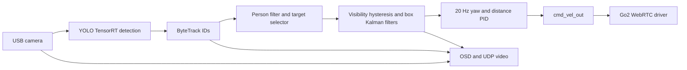

# Person tracking and following: analysis of the apptidog reference

The subsequent rover implementation is documented in [following.md](following.md).
This file records the earlier source review and its proposed adaptation.
The reference tree has since been removed from the current checkout; source
links below point to the preserved snapshot in Git history.

Prepared 2026-10-23 for future apptirover work. **Analysis only; no tracking,
following, dependency, or application-code changes were made.** The example was
not built or run, and no hardware was started. Findings below distinguish code
behavior from proposed changes; they do not assert that the user's working
Jetson deployment exhibited these failure cases.

Source snapshot: `example/apptidog/` at apptirover commit
`66da54e5114f3fdec7c56154fdc071086ab26400` (`added apptidog code as a reference`).
The existing camera integration is based on `cca913c`. The unrelated untracked
`package-lock.json` present during this review was left untouched.

**The useful part to transfer is the detector-independent tracking/control
pipeline.** Keep apptirover's NCNN detector and process isolation, then add
multi-person association, explicit target selection, timestamped state
estimation and a guarded follower. The TensorRT library accelerates detection;
it does not implement target selection or robot following.

## Source map and dependency provenance

| Source | What it actually does |
| --- | --- |
| [bringup](https://github.com/mieszkomularczyk/apptirover/blob/66da54e5114f3fdec7c56154fdc071086ab26400/example/apptidog/src/bringup/launch/bringup.launch.py) and [vision launch](https://github.com/mieszkomularczyk/apptirover/blob/66da54e5114f3fdec7c56154fdc071086ab26400/example/apptidog/src/bringup/launch/real_image.launch.py) | Connect camera, detector, tracker, target selector, follower and Go2 driver. Camera/YOLO/OSD/video share a multithreaded C++ component container with ROS intra-process communication. |
| [yolo_node.cpp](https://github.com/mieszkomularczyk/apptirover/blob/66da54e5114f3fdec7c56154fdc071086ab26400/example/apptidog/src/yolo/src/yolo_node.cpp) | Calls the TensorRT detector and publishes pixel-space boxes, confidence and class names, preserving the image header. |
| [tracker_node.py](https://github.com/mieszkomularczyk/apptirover/blob/66da54e5114f3fdec7c56154fdc071086ab26400/example/apptidog/src/tracker/tracker/tracker_node.py) | Calls Ultralytics **BYTETracker**, attaching persistent track IDs. The README mentions BOTSORT, but this implementation instantiates only ByteTrack. |
| [target_selector.py](https://github.com/mieszkomularczyk/apptirover/blob/66da54e5114f3fdec7c56154fdc071086ab26400/example/apptidog/src/follower/follower/target_selector.py) | ROS-independent candidate accumulation, ID locking and nearby-ID substitution. |
| [bbox_estimator.py](https://github.com/mieszkomularczyk/apptirover/blob/66da54e5114f3fdec7c56154fdc071086ab26400/example/apptidog/src/follower/follower/bbox_estimator.py) | ROS-independent constant-velocity Kalman estimation of center and size. |
| [target_tracker_node.py](https://github.com/mieszkomularczyk/apptirover/blob/66da54e5114f3fdec7c56154fdc071086ab26400/example/apptidog/src/follower/follower/target_tracker_node.py) | Class filtering, normalization, selection, visibility hysteresis, estimation and target overlays. |
| [follower_node.py](https://github.com/mieszkomularczyk/apptirover/blob/66da54e5114f3fdec7c56154fdc071086ab26400/example/apptidog/src/follower/follower/follower_node.py) | Two PID loops convert the selected box into forward and yaw commands. |
| [Bbox2D.msg](https://github.com/mieszkomularczyk/apptirover/blob/66da54e5114f3fdec7c56154fdc071086ab26400/example/apptidog/src/dog_msgs/msg/Bbox2D.msg) | Four normalized floats: center X/Y and width/height. No header, timestamp, track ID or prediction/validity flag. |
| [shared_qos.py](https://github.com/mieszkomularczyk/apptirover/blob/66da54e5114f3fdec7c56154fdc071086ab26400/example/apptidog/src/shared_qos/shared_qos/shared_qos.py) | Detection/box/image traffic uses best effort, volatile, depth 1; visibility uses reliable transient-local state. |
| [robot_control_service.py](https://github.com/mieszkomularczyk/apptirover/blob/66da54e5114f3fdec7c56154fdc071086ab26400/example/apptidog/src/go2_ros2_sdk/go2_robot_sdk/go2_robot_sdk/application/services/robot_control_service.py) | Adapts velocity messages to the Go2 SDK; notably drops all-zero velocity commands. |

The supplied libraries/submodules are present as **ordinary tracked source
files**, not active Git submodule checkouts in apptirover. `git submodule status
--recursive` returned no entries. The top-level declaration is named
[`gitmodules`](https://github.com/mieszkomularczyk/apptirover/blob/66da54e5114f3fdec7c56154fdc071086ab26400/example/apptidog/gitmodules), without the leading dot:

- `libs/YOLOs-CPP-TensorRT` names `https://github.com/Geekgineer/YOLOs-CPP-TensorRT.git`.
  Its detector, CUDA kernels, TensorRT session and NMS implementation were inspected.
- `src/go2_ros2_sdk` is a copied customized Go2 SDK. Its own
  [`.gitmodules`](https://github.com/mieszkomularczyk/apptirover/blob/66da54e5114f3fdec7c56154fdc071086ab26400/example/apptidog/src/go2_ros2_sdk/.gitmodules) declares
  `go2_robot_sdk/external_lib/aioice`, from `legion1581/aioice`, branch `go2`.
  That source is also present. It supplies ICE/WebRTC transport, not visual tracking.
- Original submodule commit IDs cannot be recovered from these declarations alone.
  Use the enclosing apptirover snapshot above to identify this review's source.
- Ultralytics ByteTrack and `simple-pid` are external Python dependencies, not
  included tracker/PID implementations in this example. The Docker base image is
  digest-pinned, but its installed Ultralytics version was not established here.
  `simple-pid` is unpinned and `lap` has only a lower version bound.
- For algorithm cross-checks, I read the locally installed Ultralytics **8.4.155**
  source in `/home/mieszko/rovercam/.venv-export/` and its
  [upstream versioned source](https://github.com/ultralytics/ultralytics/blob/v8.4.155/ultralytics/trackers/byte_tracker.py).
  This is not proof of the Jetson container's exact version.

The YAML references `src/yolo/models/yolo11s_new.engine` and `yolo.names`, but
`src/yolo/models/` is absent from this snapshot. Its engine input dimensions,
precision and measured deployment latency therefore remain unknown.

The user calls the working platform Jetson Nano. This copied library advertises
TensorRT 10+/CUDA 12+, and the build selects CUDA architectures `72;87`.
Record the actual Jetson variant/software stack if reproducing its build later;
the hardware nickname alone is not enough to identify that environment.

## Actual flow and enable behavior

The configured camera captures MJPEG **1280×720 at 30 FPS**. Detections leave
`/yolo/detections`, tracks leave `/tracker/detections`, and the chosen target is
published as `/target_tracker/bbox` plus `/target_tracker/visible`.
Forward/yaw output goes directly to `/cmd_vel_out`. The top-level Go2 launch
disables joystick, teleop, SLAM and navigation. No manual-priority arbiter is
implemented by the follower itself.

Initially the follower, target tracker and detection/tracking subscriptions are
disabled. `/follower/enable` asks `/target_tracker/enable`, which asks both
`/yolo/enable` and `/tracker/enable`. These are asynchronous, unchecked requests:
local enable success does not mean the whole chain acknowledged readiness.
Unavailable services are logged, without a retry/rollback handshake in this code.
The YOLO node constructs and warms its engine at startup even while unsubscribed.

Disabling clears the follower's stored box/PIDs and the target selector's
visibility history/Kalman/ID state. The ByteTrack wrapper unsubscribes but **does
not reset its tracker** on ordinary disable/enable. Changing its tuning rebuilds
the tracker, without notifying downstream code of a new track-ID generation.

There is no appearance embedding, face recognition, pose-based identity,
explicit human selection UI, measured depth, or autonomous search rotation in
this chain. It follows whichever candidate its acquisition rules choose.

## ByteTrack: what is associated, and the effective settings

The wrapper transforms each YOLO box into
`[x1, y1, x2, y2, confidence, numeric_class]`, wraps the array in Ultralytics
`Boxes`, and invokes `BYTETracker.update()`. Returned rows carry both a track ID
and the index of the matched input detection. The wrapper publishes the updated
box with that ID. Image pixels are not supplied to the tracker.

ByteTrack predicts track locations with a Kalman model, matches detections to
tracks, and can recover unmatched tracks using lower-confidence detections.
That second association stage is a central part of its design, rather than a
second neural network. [Original ByteTrack paper](https://arxiv.org/abs/2110.06864).

Effective launch YAML, which overrides several constructor defaults:

| Setting | Value | Consequence |
| --- | --- | --- |
| YOLO confidence threshold | `0.6` | Lower-confidence boxes never reach tracking. |
| YOLO NMS IoU | `0.7` | Detector overlap suppression setting. |
| `track_high_thresh` | `0.1` | Every surviving detector box is in the high group. |
| `track_low_thresh` | `0.15` | Above the high threshold; the normal low-score interval is empty. |
| `new_track_thresh` | `0.7` | New tracks need stronger evidence than continuation of existing ones. |
| `track_buffer` | `30` | Frame/update-based retention, not a 30-second timeout. |
| `match_thresh` | `0.9` | Association cost threshold; do not read this as a required 90% IoU. |
| `fuse_score` | `true` | Confidence participates in first-stage matching cost. |

Sources: [tracker YAML](https://github.com/mieszkomularczyk/apptirover/blob/66da54e5114f3fdec7c56154fdc071086ab26400/example/apptidog/src/tracker/config/tracker.yaml),
[YOLO YAML](https://github.com/mieszkomularczyk/apptirover/blob/66da54e5114f3fdec7c56154fdc071086ab26400/example/apptidog/src/yolo/config/yolo.yaml), and
[tracker wrapper](https://github.com/mieszkomularczyk/apptirover/blob/66da54e5114f3fdec7c56154fdc071086ab26400/example/apptidog/src/tracker/tracker/tracker_node.py#L142).

**Two issues change normal ByteTrack behavior here.** The high/low thresholds
are reversed, and upstream thresholding already removes weak detections. The
8.4.155 implementation defines the low group as scores above `track_low_thresh`
and below `track_high_thresh`, so these settings eliminate it. Separately, the
wrapper calls `update()` only when the detection list is nonempty. Empty frames
are published downstream but do not advance ByteTrack's internal age/prediction.
Consequently, track retention cannot be treated as a bounded real-time absence
interval. This behavior is visible at
[tracker_node.py:177](https://github.com/mieszkomularczyk/apptirover/blob/66da54e5114f3fdec7c56154fdc071086ab26400/example/apptidog/src/tracker/tracker/tracker_node.py#L177).

For a Pi adaptation, let detection, track continuation and new-target thresholds
serve distinct purposes. Feed empty observations to tracking too, pin the tracker
version/API, and express retention policy in elapsed time. Process each new
camera observation once: running a 50 Hz control loop must not count a repeated
15 FPS detection snapshot as multiple sightings.

## Choosing and retaining one person

The target node reads the first image's dimensions, then unsubscribes from images.
It filters tracker results to class name `person` and normalizes center and size
by those dimensions. Resolution changes are not handled after that first image.

`TargetSelector` implements this policy:

1. **Before lock:** record confidence samples for each nonempty track ID. Return
   the current frame's highest-confidence candidate, regardless of ID.
2. **Acquisition:** once visibility hysteresis succeeds, select the ID with the
   most recorded detections; break ties by mean confidence. It is not choosing
   the nearest person, largest box or person nearest the image center.
3. **While locked:** accept the same ID if present, ahead of all alternatives.
4. **If that ID is absent:** ask the Kalman estimator for its predicted center at
   the current time. Pick the nearest candidate within Euclidean distance `0.08`
   in normalized image coordinates, and immediately adopt its ID.
5. **On confirmed loss or disable:** clear the lock, candidate history and filter.

At 1280×720, `0.08` corresponds to a pure horizontal offset of 102.4 pixels or a
pure vertical offset of 57.6 pixels; it is not a physical distance. The distance
test has no appearance, size, ambiguity-margin or covariance check. A nearby
different person can therefore be adopted when IDs churn or people cross.
The filter preserves continuity across this substitution rather than resetting.
[Selection implementation](https://github.com/mieszkomularczyk/apptirover/blob/66da54e5114f3fdec7c56154fdc071086ab26400/example/apptidog/src/follower/follower/target_selector.py#L50).

Two less obvious details should be corrected before copying this logic:

- The advertised rolling candidate window only removes an **entire ID** when
  it has not been seen recently. It does not expire old confidence samples for a
  continuously recurring ID. During prolonged unsuccessful acquisition, counts
  can extend beyond the window and the score list can grow without a hard bound.
- On the acquisition frame, `chosen` was computed before `lock_best_candidate()`
  runs. Example: A was seen most often, but B has the highest score in the final
  frame. The node locks A yet seeds/publishes B's box for that frame. Re-select
  the newly locked ID before initializing the estimate/PID.

These follow from
[candidate recording](https://github.com/mieszkomularczyk/apptirover/blob/66da54e5114f3fdec7c56154fdc071086ab26400/example/apptidog/src/follower/follower/target_selector.py#L103)
and the order of
[selection](https://github.com/mieszkomularczyk/apptirover/blob/66da54e5114f3fdec7c56154fdc071086ab26400/example/apptidog/src/follower/follower/target_tracker_node.py#L286),
[visibility update](https://github.com/mieszkomularczyk/apptirover/blob/66da54e5114f3fdec7c56154fdc071086ab26400/example/apptidog/src/follower/follower/target_tracker_node.py#L337)
and [locking](https://github.com/mieszkomularczyk/apptirover/blob/66da54e5114f3fdec7c56154fdc071086ab26400/example/apptidog/src/follower/follower/target_tracker_node.py#L450).

## Visibility hysteresis and prediction through gaps

The effective configuration requires:

| Transition | Window | Condition |
| --- | --- | --- |
| Searching → visible | 1.0 second | At least 80% of received detection callbacks found a candidate. |
| Visible → lost | 3.0 seconds | At least 80% of received detection callbacks did not match a target. |

History must first span the relevant window and is cleared on each transition.
These are fractions of received callbacks, not time-weighted visibility, and
acquisition initially measures **any candidate**, not persistence of the eventual
winning ID. Intermittently alternating people can satisfy acquisition.

For steady frame delivery after a long visible period, sustained misses can
cross 80% of the 3-second window after roughly 2.4 seconds. Immediately after
acquisition, the cleared history must first accumulate about 3 seconds. These
are deductions from the window logic, not measured Jetson stopping times.

While still considered visible, an unmatched detection callback causes the
Kalman estimate to **coast**, and the predicted box is still published to the
follower. If all upstream messages stop, there is no timer advancing this logic:
neither visibility loss nor coasting runs. The distinction between an empty
frame and a silent/stalled pipeline is therefore essential.
[Visibility implementation](https://github.com/mieszkomularczyk/apptirover/blob/66da54e5114f3fdec7c56154fdc071086ab26400/example/apptidog/src/follower/follower/target_tracker_node.py#L423).

## Kalman estimation and outlier handling

There are two independent four-state constant-velocity filters:

- Center state: `[cx, cy, vx, vy]`.
- Size state: `[width, height, width_rate, height_rate]`.

Prediction advances position/size by rate × elapsed seconds. Each filter uses
position/size measurements with covariance from `meas_std²`, and a process-noise
matrix containing the `dt⁴/4`, `dt³/2` and `dt²` terms of an acceleration model.
Initialization uses zero velocity, measurement variance for position and unit
variance for velocity. Center noise is `process_std=1.0`, `meas_std=0.02`; size
noise is `0.5` and `0.02`. The filter uses callback receipt time, not the image's
source timestamp. [Estimator source](https://github.com/mieszkomularczyk/apptirover/blob/66da54e5114f3fdec7c56154fdc071086ab26400/example/apptidog/src/follower/follower/bbox_estimator.py).

Before correction, center residual distance is checked with plain Euclidean
distance. It is **not** a Mahalanobis/three-sigma gate, and does not account for
confidence or predicted covariance. The constructor default is `0.2`, but the
launched YAML sets `gate_threshold=3.0`. Two centers inside a normalized image
are at most approximately `1.414` apart, so `3.0` admits every such jump. It can
still reject measurements against predictions far outside the image.

An outlier is rejected five times, then the **sixth consecutive** outlier seeds
a new filter state. Rejected detections still count as detected for visibility.
Size and center are corrected together for accepted observations; size has no
independent innovation gate. Predicted sizes are floored at zero, but centers
and sizes are not bounded to the image's upper limits.

ByteTrack already has its own box Kalman state. This second filter can smooth
the selected target and operate in elapsed seconds, but it adds another source
of lag. Measure step response before assuming that both layers improve control.
The read-only `peek_center()` before `update()`/`coast()` is a useful pattern:
association can use the current prediction without advancing the filter twice.

## Following control: image centering and logarithmic width

The follower runs at **20 Hz**, independently of detection arrivals. Its
effective settings come from
[follower.yaml](https://github.com/mieszkomularczyk/apptirover/blob/66da54e5114f3fdec7c56154fdc071086ab26400/example/apptidog/src/follower/config/follower.yaml):

| Loop | Setpoint | Kp / Ki / Kd | Output limits |
| --- | --- | --- | --- |
| Yaw | center X = `0.5` | `5.0 / 3.0 / 1.7` | angular Z ±`1.0` |
| Forward/reverse | normalized width = `0.15` | `2.0 / 0.0 / 0.1` | linear X ±`3.0` |

Conceptually the proportional error signals are:

`yaw_error = 0.5 - center_x`

`distance_error = log(0.15) - log(width) = log(0.15 / width)`

A person left of center produces positive angular Z in the reference's ROS
convention. A smaller box produces positive forward output; a larger box produces
reverse output. Only X centering and **width** drive motion: center Y, height,
box area and exported image-plane velocities are not used by the follower.
Width `0.15` means 192 pixels in the reference's 1280-pixel-wide camera image.
[PID initialization](https://github.com/mieszkomularczyk/apptirover/blob/66da54e5114f3fdec7c56154fdc071086ab26400/example/apptidog/src/follower/follower/follower_node.py#L38)
and [control loop](https://github.com/mieszkomularczyk/apptirover/blob/66da54e5114f3fdec7c56154fdc071086ab26400/example/apptidog/src/follower/follower/follower_node.py#L201).

The useful intuition is multiplicative symmetry: widths `0.075` and `0.30`
produce proportional distance errors of `+log(2)` and `-log(2)`. For a fixed
projected body width and camera geometry, apparent width is approximately
inversely proportional to distance, so this resembles a log distance-ratio
controller. **It does not estimate distance in metres.** Person size, body
rotation, camera field of view and clipped/partial boxes all change the proxy.

`simple-pid` supplies output limits/integral clamping and normally differentiates
the measurement. Those limits do not supply target freshness, motor acceleration
limits or manual override. The reference requirements do not pin its version.
[simple-pid documentation](https://simple-pid.readthedocs.io/en/latest/user_guide.html).

The two axes are controlled independently. There is no explicit reduction of
forward motion when the person is far off-center, at an image edge, ambiguously
identified or represented only by a prediction. No obstacle-distance input feeds
these equations. Go2's own firmware behavior must not be assumed on WAVE ROVER.

## Behaviors to change before using this for rover motion

These are static findings with concrete adaptation consequences, not changes
made to the example:

| Finding | Why it matters | Rover requirement |
| --- | --- | --- |
| No bbox timestamp or follower input-age deadline | If target publication stops while visible, the 20 Hz loop keeps commanding from the stored box indefinitely. | Check the last real source-frame time in the motor-authority path; expire motion independently of vision callbacks. |
| NaN bbox is ignored without clearing the stored bbox | With Kalman disabled, a missed frame emits NaNs, but the follower retains the previous valid box until a separate invisible message arrives. | Explicit unavailable state clears target authority; invalid/nonfinite data cannot leave the last command active. |
| Invisible/disabled paths return without publishing zero | Stopping publications is not an explicit motor stop. | Command zero immediately on disable, loss, stale input and faults; retain the board watchdog as an additional layer. |
| Go2 control service drops all-zero velocity messages | Adding a zero Twist only at the follower would still not guarantee it reaches this SDK transport. | Use apptirover's existing UART stop path, not the Go2 adapter. Actual Go2 stop timing was not established by this review. |
| Visibility can stay true during seconds of prediction | Track continuity and permission to drive are treated as the same state. | Keep identity memory separate from fresh evidence authorizing movement; prediction must not refresh measurement age. |
| Nearby-ID substitution has no ambiguity/appearance check | A different person can inherit the lock in a crossing or occlusion. | Prefer holding/stopping when ambiguous; use geometric/size consistency and an explicit reacquisition policy. |
| Gate `3.0`, reversed ByteTrack thresholds, skipped empty updates | Configured behavior differs substantially from the documented algorithms. | Retune against recorded detections and test exact edge cases before movement. |
| Candidate window does not age individual samples | Old observations dominate acquisition and can accumulate in a long search. | Use bounded timestamped samples for each candidate and require persistence of the selected identity. |
| Acquisition box may differ from the newly locked ID | The controller may initialize on the wrong person's location for one cycle. | Select and seed atomically from the committed target. |
| No source-generation propagation to the follower | Camera/tracker restarts and ID reuse can look like continuity of the same person. | Carry camera, detector, tracker and target-session generations; reset on discontinuity. |
| Upstream enable calls are not acknowledged as a group | UI/service enabled state can differ from actual readiness. | Represent requested/starting/ready/failed separately; never arm movement merely because a request was sent. |

The first four findings follow directly from
[bbox/visibility callbacks](https://github.com/mieszkomularczyk/apptirover/blob/66da54e5114f3fdec7c56154fdc071086ab26400/example/apptidog/src/follower/follower/follower_node.py#L183),
[NaN production](https://github.com/mieszkomularczyk/apptirover/blob/66da54e5114f3fdec7c56154fdc071086ab26400/example/apptidog/src/follower/follower/target_tracker_node.py#L365),
[disable behavior](https://github.com/mieszkomularczyk/apptirover/blob/66da54e5114f3fdec7c56154fdc071086ab26400/example/apptidog/src/follower/follower/follower_node.py#L143),
and [Go2 zero suppression](https://github.com/mieszkomularczyk/apptirover/blob/66da54e5114f3fdec7c56154fdc071086ab26400/example/apptidog/src/go2_ros2_sdk/go2_robot_sdk/go2_robot_sdk/application/services/robot_control_service.py#L22).

Other boundaries to retain: target dimensions are latched from the first image;
input validation is incomplete; PID runtime parameters are accepted without
range checks; no explicit final zero appears in follower shutdown. The camera
driver stamps an image at publication, while the target node ignores even that
header and uses receipt time. Reliable/latched visibility and depth-one boxes
alone cannot establish that both messages refer to a fresh common observation.

## What YOLOs-CPP-TensorRT contributes

The used API is `yolos::det::YOLODetector::detect()`. Its implementation:

1. Loads a serialized TensorRT engine and warms it once.
2. Reuses staging/device buffers.
3. Copies image bytes into pinned host memory, then asynchronously to the GPU.
4. Runs fused CUDA letterboxing, BGR-to-RGB conversion and normalization directly
   into the engine input buffer.
5. Replays a captured CUDA inference graph for eligible fixed shapes, otherwise
   calls `enqueueV3`.
6. Copies output tensors back to host, synchronizes the stream, and performs
   detection decoding/class-aware NMS on the host for the standard YOLO head.

Sources: [detection.hpp](https://github.com/mieszkomularczyk/apptirover/blob/66da54e5114f3fdec7c56154fdc071086ab26400/example/apptidog/libs/YOLOs-CPP-TensorRT/include/yolos/tasks/detection.hpp),
[trt_session_base.hpp](https://github.com/mieszkomularczyk/apptirover/blob/66da54e5114f3fdec7c56154fdc071086ab26400/example/apptidog/libs/YOLOs-CPP-TensorRT/include/yolos/core/trt_session_base.hpp#L129),
[CUDA preprocessing](https://github.com/mieszkomularczyk/apptirover/blob/66da54e5114f3fdec7c56154fdc071086ab26400/example/apptidog/libs/YOLOs-CPP-TensorRT/include/yolos/core/cuda_preprocessing.cu),
[NMS](https://github.com/mieszkomularczyk/apptirover/blob/66da54e5114f3fdec7c56154fdc071086ab26400/example/apptidog/libs/YOLOs-CPP-TensorRT/include/yolos/core/nms.hpp).

This is useful optimized inference engineering, but not end-to-end zero-copy:
the code explicitly contains host copies, H2D/D2H transfers and synchronization.
Its synchronous `detect()` call returns after those steps. The library's README
benchmarks an RTX 2000 Ada laptop GPU and YOLO11n, not this Pi, the deployed Go2
engine, or our YOLO26n model. Do not transfer its advertised latency numbers.

The reusable principles are buffer/session reuse, small bounded work queues,
native preprocessing, controlled thread counts and profiling the complete
pipeline. CUDA kernels, CUDA graphs and serialized TensorRT engines require a
different backend on this Pi. Rewriting Python orchestration in C++ alone would
not reproduce the NVIDIA hardware acceleration.

## ARM/Raspberry Pi inference options

**Keep NCNN as the first choice.** It is already a native C++ inference runtime
with Python bindings, optimized ARM NEON/multicore CPU kernels, optional Vulkan
and quantization support. Our code explicitly selects CPU inference, two NCNN
threads and one OpenCV thread; only the surrounding orchestration is Python.
[NCNN upstream](https://github.com/Tencent/ncnn) and
[current detector](../apptirover/vision/detection.py#L103).

The recorded September camera test achieved about 22 ms median inference with
YOLO26n at a 320-pixel feed, while video ran near 30 FPS and detection was capped
at 15 FPS. Those are historical project measurements, not new benchmarks or a
comparison against the larger/different Jetson engine. See [camera notes](camera.md).

| Option | Assessment for this project |
| --- | --- |
| Existing NCNN CPU backend | Lowest integration cost. Profile tracking plus inference first; try supported model optimization/quantization only with accuracy and control-latency checks. |
| NCNN Vulkan | Optional experiment if the installed Pi GPU driver and NCNN build support the necessary path. This review did not verify that combination or any speedup; CPU remains the baseline. |
| ONNX Runtime with XNNPACK | Another optimized ARM CPU option that can be built for Linux. Requires an appropriate model/export and provider-enabled build; unsupported operators may fall back to the CPU provider. Benchmark the same model and manage both thread pools. [Official XNNPACK provider documentation](https://onnxruntime.ai/docs/execution-providers/Xnnpack-ExecutionProvider.html). |
| Hailo accelerator / Raspberry Pi AI HAT | Additional hardware can offload supported models. The official Pi stack supports Hailo AI HATs, but model/toolchain compatibility and this USB-camera pipeline would need an explicit integration check. This is not a transparent replacement for a TensorRT engine or a purchase recommendation. [Raspberry Pi AI documentation](https://www.raspberrypi.com/documentation/accessories/ai-hat-plus.html). |

Tracking and the small Kalman/PID calculations do not require NVIDIA inference.
Avoid installing the full Ultralytics/PyTorch runtime solely for association if
a pinned standalone tracker can satisfy the same interface and tests. CPU cost
of the eventual tracker has not been measured here.

Library provenance for future reuse: the copied YOLOs-CPP-TensorRT library ships
AGPL-3.0; the Go2 root ships BSD-2-Clause (some individual files carry BSD-3-Clause
SPDX headers); `aioice` has its own BSD license. Preserve applicable source
notices when reusing material. This review did not copy implementation code.

## Suggested adaptation boundary for apptirover — not implemented

1. Preserve the current camera and inference processes. Add detector-independent
   association/target estimation off the UART thread; the existing camera process
   is a reasonable initial home for lightweight tracking, subject to profiling.
2. Consume each distinct observation using its process/capture/detection
   generation plus frame sequence. Our boxes are already normalized corner
   coordinates; derive center and size without re-normalizing by pixels.
3. Publish a target snapshot with target ID/session, measured-versus-predicted
   flag, last real observation time, prediction time, confidence/ambiguity,
   position/size and velocity. Keep last real evidence age distinct from the
   time a prediction or heartbeat was generated.
4. Add explicit disabled/acquiring/following/holding-or-lost/fault states.
   Allow longer identity retention than motion permission. Camera recovery,
   detection toggles and manual takeover invalidate autonomous authority.
5. Evaluate a small follower controller from fresh snapshots through a motion
   arbiter in the existing control path. Joystick control has priority and
   cancels following; centering the stick does not silently resume autonomy.
6. Keep one UART owner and all current neutral, input-health and motor watchdog
   behavior. Stop commands bypass ramps. The camera/tracker must never write
   motors or wait synchronously on the control loop.
7. Start with conservative proportional/PD control and explicit deadbands,
   limits, heading-dependent forward reduction and a maximum observation age.
   Calibrate desired apparent width for the actual camera/person geometry.
   The Jetson gains and ±3 velocity limit are not rover defaults.

There is also a sign/units conversion to make deliberately: the reference uses
positive ROS yaw for left turns; apptirover's positive `turn` turns the nose
right. Its current motor interface is normalized PWM power with no encoders,
not calibrated m/s or rad/s. Preserve the log-width idea if useful, but retune
its output as bounded motor demand rather than claiming velocity control.

The present `DriveControl` consumes a controller snapshot directly. Future
autonomy requires an explicit authority/refactoring step; merely attaching
target data to the CLI is insufficient. The existing `CameraMonitor.snapshot()`
freshness/generation contract is the appropriate starting point. In particular,
the current 500 ms observation-validity limit must not be extended just because
a Kalman filter can continue making predictions.

## Checks to perform before any future motion implementation is accepted

Use recorded/synthetic detections and the existing pseudo-UART harness first:

- One person entering/leaving, irregular detector rates and dropped observations.
- Two people crossing, one briefly occluding the target, and ambiguous nearby IDs.
- Different per-frame score winner versus accumulated ID winner at acquisition.
- ID reuse, camera/detector/tracker restart and enable/disable mid-track.
- Empty valid detections versus total upstream silence; both must revoke motion
  on the chosen deadline without waiting for visibility callbacks.
- NaN/infinite/zero/negative/clipped boxes, resolution changes and stale frames.
- Predicted size shrinking to zero and growing outside the image; no stale or
  predicted box may manufacture fresh evidence.
- Manual takeover during acquisition, following, loss and recovery; no automatic
  resumption when the controller returns to neutral.
- Sign of left/right turns, heading-versus-forward coupling, bounded outputs,
  immediate zero on disable/shutdown, and one motor-command owner.
- End-to-end source-frame age, target-switch rate, control-loop gap and telemetry
  freshness under combined streaming/inference/tracking load.

Physical tests would then need coordination with the user and the existing rover
safety constraints. No such tests, code changes or dependency installations were
part of this analysis.
